# Laboratorio: AAA con RADIUS y NPS

**Seguridad de autenticación y autorización en Router y Switch Cisco con niveles de privilegio desde Active Directory**

| | |
|---|---|
| **Estudiante** | Angel Alcántara |
| **Matrícula** | 2024-2356 |
| **Carrera** | Ciberseguridad |
| **Asignatura** | Seguridad de Redes |
| **Práctica** | Asignacion 2 |
| **Fecha** | 28 de octubre de 2026 |

---

## 🎥 Video demostrativo

> **[▶ Ver el video en YouTube](https://youtu.be/1lRJLfQgbug)**

El video muestra, en vivo, cómo la topología cumple su objetivo de seguridad: autenticación centralizada por RADIUS, autorización por niveles de privilegio, logs y acceso restringido por SSH.

---

## 1. Propósito del laboratorio

El objetivo es asegurar la administración de un router y un switch Cisco usando **AAA (Authentication, Authorization, Accounting)** contra un servidor **RADIUS**, en lugar de usuarios locales sueltos.

El servidor es un **Windows Server con Active Directory y el rol NPS** (Network Policy Server). Cada administrador pertenece a un grupo de AD, y según su grupo el NPS le asigna un **nivel de privilegio de Cisco (0, 5 o 10)**. Así, un mismo inicio de sesión da permisos distintos sin configurar nada extra en los equipos.

Puntos que cumple la topología:

- Autenticación y autorización centralizadas en RADIUS para los puertos de **consola y auxiliar**.
- Tres **niveles de privilegio** (0, 5 y 10) asignados por grupo de AD.
- **Usuario local de respaldo** por si el NPS no responde.
- **Servicio SSH** restringido con ACL y usuario local.
- **Logs** de autenticación, autorización y RADIUS, tanto en los equipos como en el NPS.
- **Red de gestión fuera de banda (OOB)** filtrada, sin salida a Internet.

---

## 2. Topología y direccionamiento

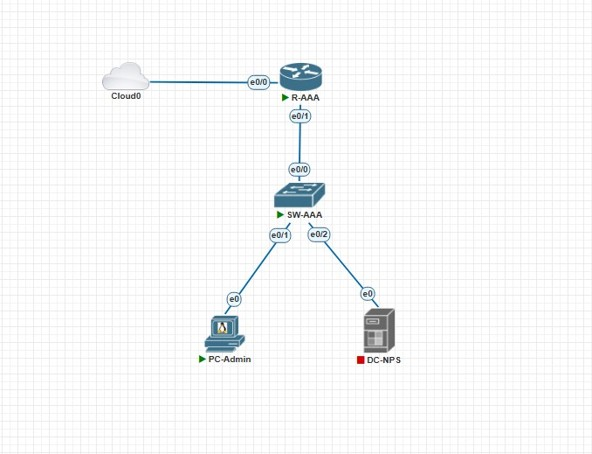

*Figura 1. Topología implementada en PNETLab: router, switch, servidor y PC de administración.*

La red se montó sin ISP: todo el tráfico de autenticación es interno. La nube (Cloud0) es solo una **red de gestión fuera de banda** para administrar los equipos desde la PC del laboratorio.

### Diagrama lógico

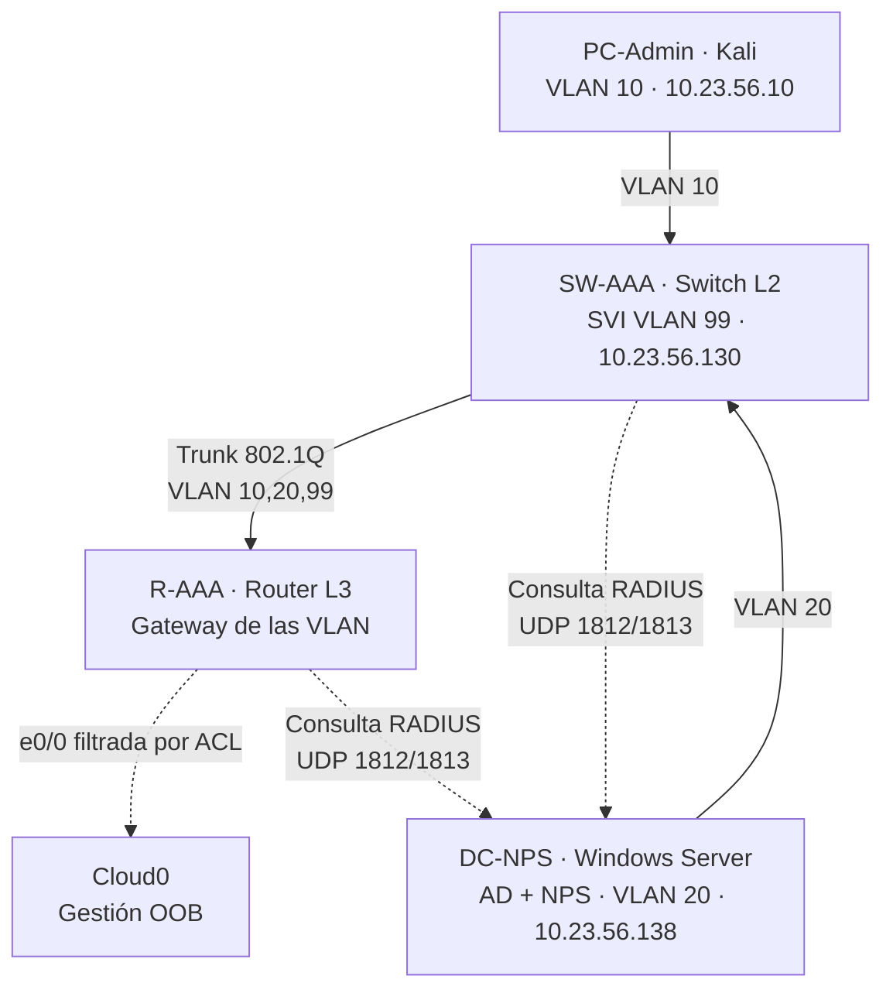

### Direccionamiento (base: matrícula 2024-2356)

| Segmento | Red | Gateway | Equipos |
|---|---|---|---|
| VLAN 10 - Admin | 10.23.56.0/25 | 10.23.56.1 (R-AAA) | PC-Admin por DHCP (.10 a .100) |
| VLAN 20 - Servidores | 10.23.56.136/29 | 10.23.56.137 (R-AAA) | DC-NPS .138 |
| VLAN 99 - Gestión | 10.23.56.128/29 | 10.23.56.129 (R-AAA) | SW-AAA .130 |
| VLAN 999 | Nativa | — | Sin uso |
| Gestión OOB | 192.168.128.0/24 | — | e0/0 del router, PC del admin .1 |

---

## 3. Active Directory y NPS

En el dominio `itla.local` se creó la OU **Red-AAA** con tres grupos y un usuario por grupo.

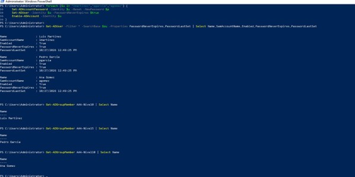

*Figura 2. OU Red-AAA con los grupos AAA-Nivel0, AAA-Nivel5 y AAA-Nivel10 y sus usuarios.*

| Grupo de AD | Usuario | Nivel Cisco |
|---|---|---|
| AAA-Nivel0 | lmartinez (Luis Martínez) | 0 |
| AAA-Nivel5 | pgarcia (Pedro García) | 5 |
| AAA-Nivel10 | agomez (Ana Gómez) | 10 |

En el NPS se registraron el router y el switch como **clientes RADIUS**, y se crearon tres **Network Policies**, una por grupo.

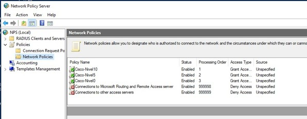

*Figura 3. Las tres políticas (Cisco-Nivel10, Cisco-Nivel5, Cisco-Nivel0) por encima de las políticas Deny por defecto.*

Cada política entrega el atributo **Cisco-AV-Pair = `shell:priv-lvl=X`** según el grupo.

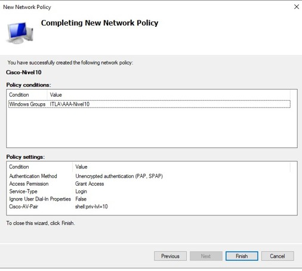

*Figura 4. Resumen de la política Cisco-Nivel10 con el atributo shell:priv-lvl=10.*

La autenticación se configuró en **PAP**, porque es el método que usa Cisco IOS para enviar la contraseña por RADIUS. La contraseña viaja ofuscada con el shared secret.

---

## 4. Configuración de los equipos Cisco

El router y el switch se configuraron como clientes RADIUS. Lo esencial:

- **Consola y auxiliar:** autenticación y autorización por RADIUS, con usuario local de respaldo (`group GRUPO-NPS local`).
- **VTY (SSH):** solo usuario local, restringido con la ACL `SSH-ADMIN`.
- **Niveles de privilegio:** comandos asignados a los niveles 5 y 10 con `privilege exec level`.
- **Logs:** `login on-success/on-failure log`, `aaa accounting exec` y `archive log config` para registrar comandos.

> Las configuraciones completas están al final de este documento, en la sección [Running-configs](#running-configs).

### Prueba de autenticación contra el NPS

Antes de aplicar AAA a las líneas, se validó con `test aaa` que cada usuario recibiera su nivel:

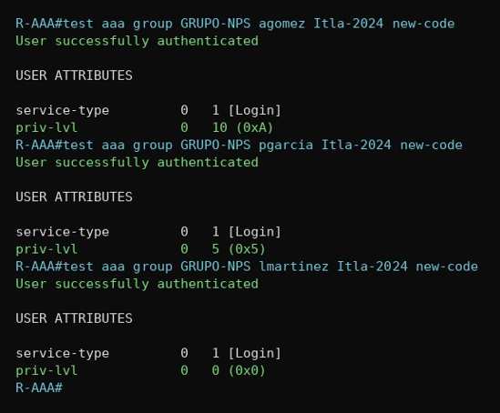

*Figura 5. test aaa: cada usuario autentica contra el NPS y recibe priv-lvl 10, 5 y 0.*

---

## 5. Pruebas de niveles de privilegio

### Nivel 0 — lmartinez

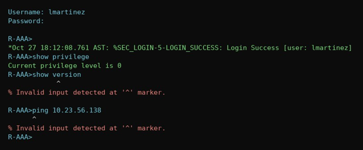

*Figura 6. lmartinez tiene nivel 0: el prompt es `>` y `show version` está bloqueado.*

### Nivel 5 — pgarcia

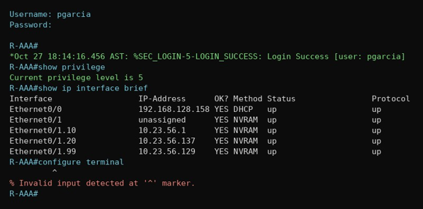

*Figura 7. pgarcia tiene nivel 5: ve las interfaces, pero no puede entrar a configurar.*

### Nivel 10 — agomez

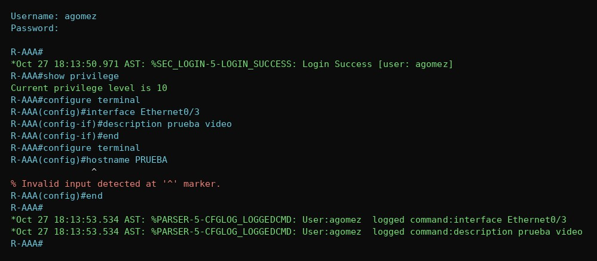

*Figura 8. agomez tiene nivel 10: configura interfaces, pero no puede cambiar el hostname. Cada comando queda registrado con su usuario.*

### Escalada de privilegios con enable

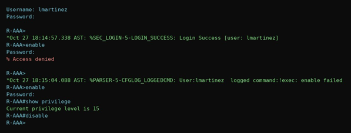

*Figura 9. Un usuario de nivel bajo solo sube a nivel 15 con el enable secret. El intento fallido y el exitoso quedan registrados.*

### Switch — mismo comportamiento

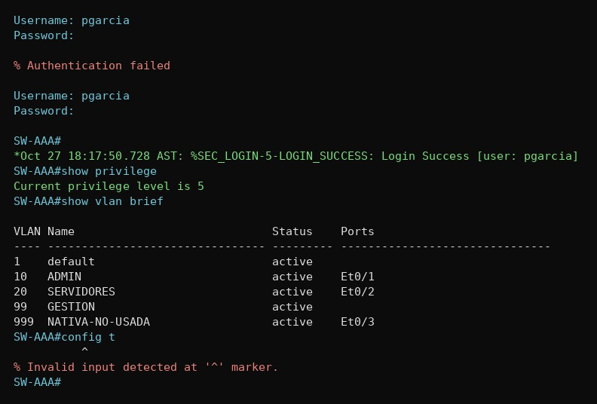

*Figura 10. El switch es otro cliente RADIUS del mismo NPS: pgarcia tiene nivel 5 también aquí.*

---

## 6. Logs

### En los equipos Cisco

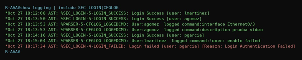

*Figura 11. `show logging`: logins exitosos y fallidos, intentos de enable y comandos por usuario.*

### En el NPS

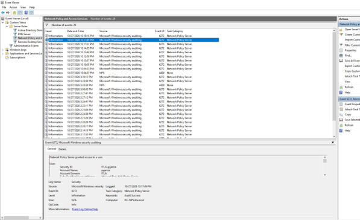

*Figura 12. Eventos del NPS: 6272 (acceso concedido, con política aplicada) y 6273 (rechazo, con el motivo).*

![Detalle del evento 6273]

*Figura 13. Detalle del evento 6273: usuario, cliente RADIUS, tipo PAP y motivo del rechazo.*

Los eventos del NPS coinciden en hora con los logs `%SEC_LOGIN` de los equipos, lo que demuestra la correlación entre el equipo y el servidor.

---

## 7. Servicio SSH y red de gestión

El SSH solo acepta el usuario local y está restringido por la ACL `SSH-ADMIN`. Los usuarios del dominio no pueden entrar por SSH, porque la autenticación RADIUS aplica solo a consola y auxiliar.

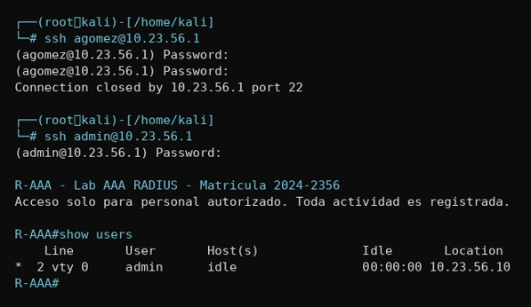

*Figura 14. Desde PC-Admin: el usuario del dominio es rechazado por SSH; el usuario local entra. `show users` muestra la sesión con origen 10.23.56.10.*

La red de gestión (Cloud0) está filtrada en las dos direcciones con las ACL `GESTION-IN` y `GESTION-OUT`: solo deja pasar la PC del administrador por SSH y RDP, y el laboratorio no tiene salida a Internet.

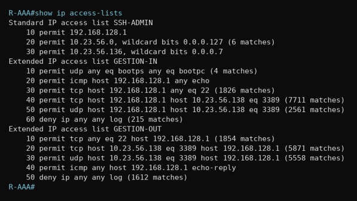

*Figura 15. Contadores de las ACL: tráfico permitido (SSH, RDP) y bloqueado (deny con log).*

---

## 8. Problemas encontrados

![Regla de firewall para RADIUS]

*Figura 16. Regla de firewall entrante para UDP 1812/1813, limitada al router y al switch.*

| Problema | Solución |
|---|---|
| El rol NPS no abrió el puerto UDP 1812 en el firewall de Windows, y el router veía al servidor como "no responde". | Se creó una regla de firewall entrante para UDP 1812/1813, limitada a las IP del router y el switch. |
| El switch (IOL L2) trae `ip routing` activo e ignora el `ip default-gateway`, por lo que no respondía fuera de su red. | Se agregó una ruta por defecto estática: `ip route 0.0.0.0 0.0.0.0 10.23.56.129`. |
| El orden de los comandos `privilege` importaba: la palabra padre `show` quedaba con el nivel del último comando, y los niveles bajos no podían usar ningún `show`. | Se reaplicaron los comandos `privilege` de mayor a menor nivel. |
| El OpenSSH moderno de Kali ofrecía tantos algoritmos que el IOL cerraba la conexión. | Se fijó la lista exacta de algoritmos (KEX, HostKey, MAC, Cipher) en el cliente SSH. |
| El comando `security passwords min-length` no existe en la imagen IOL L2. | Se omitió en el switch; las contraseñas ya cumplen la longitud mínima. |
| Tras un apagado no controlado, Windows leyó el reloj virtual (UTC) como hora local y el NPS quedó 4 horas adelantado. | Se corrigió la hora y se agregó `RealTimeIsUniversal=1` en el registro para que lea el reloj virtual como UTC. |

---

## 9. Conclusión

El laboratorio cumple el objetivo de seguridad de redes: la administración del router y el switch pasó de usuarios locales a un modelo AAA centralizado en RADIUS. Cada administrador recibe su nivel de privilegio según su grupo de Active Directory, lo que facilita dar y quitar permisos desde un solo lugar. El acceso por SSH está restringido, hay un usuario local de respaldo por si el NPS cae, y toda la actividad queda registrada tanto en los equipos como en el servidor. Además, la red de gestión quedó aislada de Internet y filtrada, de modo que solo la PC del administrador puede llegar a los equipos.

---

## Estructura del repositorio

```
.
├── README.md
├── configs/
│   ├── R-AAA_running-config.txt
│   ├── SW-AAA_running-config.txt
│   └── NPS-Config.xml
├── scripts/
│   ├── R-AAA.txt
│   ├── SW-AAA.txt
│   ├── DC-NPS.ps1
│   └── PC-Admin.sh
└── img/
    ├── 01-topologia-pnetlab.png
    ├── 02-ad-grupos-usuarios.png
    ├── 03-nps-network-policies.png
    ├── 04-nps-cisco-avpair.png
    ├── 05-test-aaa-router.png
    ├── 06-nivel0-lmartinez.png
    ├── 07-nivel5-pgarcia.png
    ├── 08-nivel10-agomez.png
    ├── 09-enable-nivel15.png
    ├── 10-switch-nivel5.png
    ├── 11-logs-router.png
    ├── 12-nps-eventos.png
    ├── 13-nps-evento-6273.png
    ├── 14-ssh-kali.png
    └── 15-acl-gestion.png
```

---

## Running-configs

<details>
<summary><b>R-AAA — running-config</b></summary>

```
Building configuration...

Current configuration : 4536 bytes
!
version 15.4
service timestamps debug datetime msec localtime show-timezone
service timestamps log datetime msec localtime show-timezone
service password-encryption
!
hostname R-AAA
!
security passwords min-length 8
logging buffered 64000
logging console notifications
enable secret 9 <HASH>
!
aaa new-model
!
aaa group server radius GRUPO-NPS
 server name NPS
!
aaa authentication login CON-AUX group GRUPO-NPS local
aaa authentication login VTY-SSH local
aaa authentication enable default enable
aaa authorization console
aaa authorization exec CON-AUX group GRUPO-NPS local
aaa authorization exec VTY-SSH local
aaa accounting exec CON-AUX start-stop group GRUPO-NPS
!
aaa session-id common
clock timezone AST -4 0
!
ip dhcp excluded-address 10.23.56.1 10.23.56.9
ip dhcp excluded-address 10.23.56.101 10.23.56.127
!
ip dhcp pool VLAN10-ADMIN
 network 10.23.56.0 255.255.255.128
 default-router 10.23.56.1
 dns-server 10.23.56.138
 domain-name itla.local
!
no ip domain lookup
ip domain name itla.local
ip cef
login block-for 120 attempts 3 within 60
login on-failure log
login on-success log
!
archive
 log config
  logging enable
  notify syslog contenttype plaintext
  hidekeys
username admin privilege 15 secret 9 <HASH>
!
ip ssh time-out 60
ip ssh logging events
ip ssh version 2
!
interface Ethernet0/0
 description Gestion OOB - Cloud0
 ip address dhcp
 ip access-group GESTION-IN in
 ip access-group GESTION-OUT out
!
interface Ethernet0/1
 description Trunk hacia SW-AAA e0/0
 no ip address
!
interface Ethernet0/1.10
 description VLAN 10 - Admin
 encapsulation dot1Q 10
 ip address 10.23.56.1 255.255.255.128
 ip tcp adjust-mss 1360
!
interface Ethernet0/1.20
 description VLAN 20 - Servidores
 encapsulation dot1Q 20
 ip address 10.23.56.137 255.255.255.248
 ip tcp adjust-mss 1360
!
interface Ethernet0/1.99
 description VLAN 99 - Gestion
 encapsulation dot1Q 99
 ip address 10.23.56.129 255.255.255.248
!
interface Ethernet0/2
 no ip address
 shutdown
!
interface Ethernet0/3
 no ip address
 shutdown
!
no ip http server
no ip http secure-server
!
ip access-list standard SSH-ADMIN
 permit 192.168.128.1
 permit 10.23.56.0 0.0.0.127
 permit 10.23.56.136 0.0.0.7
!
ip access-list extended GESTION-IN
 remark Solo la PC del administrador por SSH y RDP
 permit udp any eq bootps any eq bootpc
 permit icmp host 192.168.128.1 any echo
 permit tcp host 192.168.128.1 any eq 22
 permit tcp host 192.168.128.1 host 10.23.56.138 eq 3389
 permit udp host 192.168.128.1 host 10.23.56.138 eq 3389
 deny   ip any any log
ip access-list extended GESTION-OUT
 remark Solo respuestas hacia la PC del administrador
 permit tcp any eq 22 host 192.168.128.1
 permit tcp host 10.23.56.138 eq 3389 host 192.168.128.1
 permit udp host 10.23.56.138 eq 3389 host 192.168.128.1
 permit icmp any host 192.168.128.1 echo-reply
 deny   ip any any log
!
ip radius source-interface Ethernet0/1.20
!
radius server NPS
 address ipv4 10.23.56.138 auth-port 1812 acct-port 1813
 key 7 <SHARED-SECRET>
!
privilege interface level 10 shutdown
privilege interface level 10 description
privilege configure level 10 interface
privilege exec level 5 traceroute
privilege exec level 5 ping
privilege exec level 10 configure terminal
privilege exec level 10 configure
privilege exec level 5 show ip route
privilege exec level 5 show ip interface brief
privilege exec level 5 show ip interface
privilege exec level 5 show ip
privilege exec level 10 show logging
privilege exec level 10 show running-config
privilege exec level 0 show privilege
privilege exec level 5 show interfaces
privilege exec level 0 show
banner motd ^C
R-AAA - Lab AAA RADIUS - Matricula 2024-2356
Acceso solo para personal autorizado. Toda actividad es registrada.
^C
!
line con 0
 authorization exec CON-AUX
 accounting exec CON-AUX
 logging synchronous
 login authentication CON-AUX
line aux 0
 authorization exec CON-AUX
 accounting exec CON-AUX
 login authentication CON-AUX
line vty 0 4
 access-class SSH-ADMIN in
 authorization exec VTY-SSH
 login authentication VTY-SSH
 transport input ssh
!
end
```

</details>

<details>
<summary><b>SW-AAA — running-config</b></summary>

```
Building configuration...

Current configuration : 3692 bytes
!
version 15.2
service timestamps debug datetime msec localtime show-timezone
service timestamps log datetime msec localtime show-timezone
service password-encryption
service compress-config
!
hostname SW-AAA
!
logging buffered 64000
logging console notifications
enable secret 9 <HASH>
!
username admin privilege 15 secret 9 <HASH>
aaa new-model
!
aaa group server radius GRUPO-NPS
 server name NPS
!
aaa authentication login CON-AUX group GRUPO-NPS local
aaa authentication login VTY-SSH local
aaa authentication enable default enable
aaa authorization console
aaa authorization exec CON-AUX group GRUPO-NPS local
aaa authorization exec VTY-SSH local
aaa accounting exec CON-AUX start-stop group GRUPO-NPS
!
aaa session-id common
clock timezone AST -4 0
!
no ip domain-lookup
ip domain-name itla.local
ip cef
login block-for 120 attempts 3 within 60
login on-failure log
login on-success log
!
archive
 log config
  logging enable
  notify syslog contenttype plaintext
  hidekeys
!
spanning-tree mode rapid-pvst
spanning-tree extend system-id
!
interface Ethernet0/0
 description Trunk hacia R-AAA e0/1
 switchport trunk allowed vlan 10,20,99
 switchport trunk encapsulation dot1q
 switchport trunk native vlan 999
 switchport mode trunk
 switchport nonegotiate
!
interface Ethernet0/1
 description PC-Admin (VLAN 10)
 switchport access vlan 10
 switchport mode access
 spanning-tree portfast edge
!
interface Ethernet0/2
 description DC-NPS (VLAN 20)
 switchport access vlan 20
 switchport mode access
 spanning-tree portfast edge
!
interface Ethernet0/3
 description No usado
 switchport access vlan 999
 switchport mode access
 shutdown
!
interface Vlan99
 description Gestion
 ip address 10.23.56.130 255.255.255.248
!
ip default-gateway 10.23.56.129
!
no ip http server
no ip http secure-server
!
ip route 0.0.0.0 0.0.0.0 10.23.56.129
ip ssh time-out 60
ip ssh logging events
ip ssh version 2
!
ip access-list standard SSH-ADMIN
 permit 192.168.128.1
 permit 10.23.56.0 0.0.0.127
 permit 10.23.56.136 0.0.0.7
!
ip radius source-interface Vlan99
!
radius server NPS
 address ipv4 10.23.56.138 auth-port 1812 acct-port 1813
 key 7 <SHARED-SECRET>
!
privilege interface level 10 shutdown
privilege interface level 10 description
privilege configure level 10 interface
privilege exec level 5 ping
privilege exec level 10 configure terminal
privilege exec level 10 configure
privilege exec level 5 show mac address-table
privilege exec level 5 show mac
privilege exec level 5 show ip interface brief
privilege exec level 5 show ip interface
privilege exec level 5 show ip
privilege exec level 5 show vlan brief
privilege exec level 5 show vlan
privilege exec level 10 show running-config
privilege exec level 10 show logging
privilege exec level 0 show privilege
privilege exec level 5 show interfaces
privilege exec level 0 show
banner motd ^C
SW-AAA - Lab AAA RADIUS - Matricula 2024-2356
Acceso solo para personal autorizado. Toda actividad es registrada.
^C
!
line con 0
 authorization exec CON-AUX
 accounting exec CON-AUX
 logging synchronous
 login authentication CON-AUX
line aux 0
 authorization exec CON-AUX
 accounting exec CON-AUX
 login authentication CON-AUX
line vty 0 4
 access-class SSH-ADMIN in
 authorization exec VTY-SSH
 login authentication VTY-SSH
 transport input ssh
!
end
```

</details>

<details>
<summary><b>DC-NPS — script de configuración (PowerShell)</b></summary>

```powershell
# Red y nombre
New-NetIPAddress -InterfaceAlias "Ethernet" -IPAddress 10.23.56.138 -PrefixLength 29 -DefaultGateway 10.23.56.137
Rename-NetAdapter -Name "Ethernet" -NewName "LAN-SERVIDORES"
Set-TimeZone -Id "SA Western Standard Time"
Rename-Computer -NewName "DC-NPS" -Restart

# Active Directory + DNS
Install-WindowsFeature AD-Domain-Services -IncludeManagementTools
Install-ADDSForest -DomainName "itla.local" -DomainNetbiosName "ITLA" -InstallDns -Force -SafeModeAdministratorPassword (Read-Host -AsSecureString "Contrasena DSRM")
Set-DnsClientServerAddress -InterfaceAlias "LAN-SERVIDORES" -ServerAddresses 127.0.0.1

# OU, grupos y usuarios
New-ADOrganizationalUnit -Name "Red-AAA" -Path "DC=itla,DC=local"
$ou = "OU=Red-AAA,DC=itla,DC=local"
New-ADGroup -Name "AAA-Nivel0"  -GroupScope Global -Path $ou -Description "Privilegio 0"
New-ADGroup -Name "AAA-Nivel5"  -GroupScope Global -Path $ou -Description "Privilegio 5"
New-ADGroup -Name "AAA-Nivel10" -GroupScope Global -Path $ou -Description "Privilegio 10"
$p = Read-Host -AsSecureString "Contrasena de los usuarios"
New-ADUser -Name "Luis Martinez" -SamAccountName "lmartinez" -UserPrincipalName "lmartinez@itla.local" -Path $ou -AccountPassword $p -Enabled $true -PasswordNeverExpires $true
New-ADUser -Name "Pedro Garcia"  -SamAccountName "pgarcia"   -UserPrincipalName "pgarcia@itla.local"   -Path $ou -AccountPassword $p -Enabled $true -PasswordNeverExpires $true
New-ADUser -Name "Ana Gomez"     -SamAccountName "agomez"    -UserPrincipalName "agomez@itla.local"    -Path $ou -AccountPassword $p -Enabled $true -PasswordNeverExpires $true
Add-ADGroupMember -Identity "AAA-Nivel0"  -Members "lmartinez"
Add-ADGroupMember -Identity "AAA-Nivel5"  -Members "pgarcia"
Add-ADGroupMember -Identity "AAA-Nivel10" -Members "agomez"

# NPS y clientes RADIUS
Install-WindowsFeature NPAS -IncludeManagementTools
Add-ADGroupMember -Identity "RAS and IAS Servers" -Members "DC-NPS$"
Restart-Service IAS
New-NpsRadiusClient -Name "R-AAA"  -Address 10.23.56.137 -SharedSecret "<SHARED-SECRET>"
New-NpsRadiusClient -Name "SW-AAA" -Address 10.23.56.130 -SharedSecret "<SHARED-SECRET>"
New-NetFirewallRule -DisplayName "RADIUS desde R-AAA y SW-AAA" -Direction Inbound -Protocol UDP -LocalPort 1812,1813 -RemoteAddress 10.23.56.137,10.23.56.130 -Action Allow
Restart-Service IAS
auditpol /set /subcategory:"Network Policy Server" /success:enable /failure:enable

# Network Policies (GUI: nps.msc):
#   Cisco-Nivel10 | ITLA\AAA-Nivel10 | Cisco-AV-Pair = shell:priv-lvl=10
#   Cisco-Nivel5  | ITLA\AAA-Nivel5  | Cisco-AV-Pair = shell:priv-lvl=5
#   Cisco-Nivel0  | ITLA\AAA-Nivel0  | Cisco-AV-Pair = shell:priv-lvl=0
#   Autenticacion: solo PAP | Standard: quitar Framed-Protocol, Service-Type = Login
```

</details>

<details>
<summary><b>PC-Admin (Kali) — configuración de cliente SSH</b></summary>

```bash
# El OpenSSH de Kali ofrece tantos algoritmos que el IOL cierra la conexion;
# se fija la lista exacta que soporta el IOL
cat >> ~/.ssh/config << 'EOF'
Host 10.23.56.1 10.23.56.130
    KexAlgorithms diffie-hellman-group14-sha1
    HostKeyAlgorithms ssh-rsa
    MACs hmac-sha1
    Ciphers aes128-ctr
EOF

# Pruebas de SSH (solo usuario local 'admin')
ssh admin@10.23.56.1      # R-AAA
ssh admin@10.23.56.130    # SW-AAA
```

</details>
